# cb-api-prober

[](https://www.python.org/downloads/)
[](#features)
[](./docs/user-guide.md)
[](#testing)

A fast, zero-dependency, declarative **Website, JSON REST API, and LLM Inference Prober CLI** written in idiomatic Python.

`cb-api-prober` lets you define modular **TOML scan configurations** with central variables, secure relative file imports, reusable named checkers, and concurrent probes to validate everything from HTML pages and REST endpoints to OpenAI Chat Completions, OpenAI Responses, and Anthropic Messages (including SSE streaming and tool calling).

---

## Table of Contents

- [Features](#features)
- [Architecture](#architecture)
- [Quickstart](#quickstart)
- [CLI Reference](#cli-reference)
- [Writing Scan Configs (TOML)](#writing-scan-configs-toml)
- [Fetchers Overview](#fetchers-overview)
- [Checkers & Predicates Overview](#checkers--predicates-overview)
- [Example Console Output](#example-console-output)
- [Documentation](#documentation)
- [Testing](#testing)

---

## Features

- **Zero External Dependencies** — Built strictly on the Python 3.11+ standard library (`tomllib`, `urllib.request`, `ssl`, `concurrent.futures`). No `pip install` or virtual environment required.
- **First-Class HTTP, JSON & LLM Fetchers** — Dedicated fetchers for `http_get`, `http_post`, `http_json`, `openai_chat_request` (`/v1/chat/completions`), `openai_responses_request` (`/v1/responses`), and `anthropic_messages_request` (`/v1/messages`).
- **SSE Streaming & Tool-Call Normalization** — Automatically parses `text/event-stream` frames (`[DONE]`, `message_stop`, `response.completed`), detects HTTP 200 mid-stream error events, and normalizes assistant text, token usage, per-request USD cost (`$0.00000348`), and tool calls.
- **Composable Functional Checkers** — Validate status codes (`http_status`), latency bounds (`response_time`, e.g. `<= 500ms`), raw HTML/text & regex (`content`), HTTP headers (`header`), JSON dot-paths & `*` wildcard projections (`json_path`), recursive Draft-7/2020-12 JSON Schemas (`json_schema`), and normalized LLM outputs (`llm_response`).
- **Declarative TOML Config Language** — Supports `[variables]` with `${var}` / `${var:-default}` interpolation, environment variable and CLI (`--var key=val`) overrides, and modular `imports` with strict path-traversal protection (`ConfigSecurityError`).
- **Concurrent Execution & Smart Retries** — Parallel worker pool (`--max-concurrent`), tag filtering (`--tags`), probe order randomization (`--randomize`), fail-fast cancellation (`--abort_on_failure`), per-probe retry budgets (`retries = 3`, `timeout = "10s"`), and full HTTP request/response debug dumps (`--include-debug`).

---

## Architecture

```mermaid
flowchart LR
    CLI["CLI (prober)\nargparse + Exit Codes"] --> Loader["ConfigLoader (TOML)\nSecure Imports + ${var} Resolver"]
    Loader --> Plan["ExecutionPlan\nTag Filter + Randomizer"]
    Plan --> Executor["ScanRunner\nThreadPoolExecutor + Retries"]
    Executor --> Fetcher["Fetcher (ABC)\nHTTP / JSON / OpenAI / Anthropic"]
    Fetcher --> Response["ProbeResponse\nStatus + Headers + JSON + LLMResult"]
    Response --> Checkers["Checkers (ABC)\nFunctional Predicates + JSON Schema"]
    Checkers --> Reporter["ConsoleReporter\nLive Progress + USD Cost + Summary"]
```



---

## Quickstart

### 1. Clone the Repository
```bash
git clone https://github.com/your-org/cb-api-prober.git
cd cb-api-prober
```

### 2. Run a Scan
```bash
# Linux / macOS / Git Bash
./prober --scan-config="scan-config/coralbricks/main.toml" --tags="public"

# Windows (CMD / PowerShell)
.\prober.cmd --scan-config="scan-config/coralbricks/main.toml" --tags="public"

# Or invoke via Python directly
python ./prober.py --scan-config="scan-config/coralbricks/main.toml" --tags="public"
```

### 3. Pass API Keys or Variable Overrides
```bash
./prober --scan-config="scan-config/coralbricks/main.toml" \
         --max-concurrent=10 \
         --var coralbricks_api_key="cb_your_api_key"
```
Or use the included Windows batch runner:
```cmd
run_coralbricks.bat
```

---

## CLI Reference

```text
./prober --scan-config="path/to/main.toml" \
         [--tags="smoke, public, auth"] \
         [--max-concurrent=20] \
         [--randomize=true|false] \
         [--abort_on_failure] \
         [--include-debug=true|false] \
         [--report-performance=true|false] \
         [--var KEY=VALUE]
```

| Flag | Default | Description |
| :--- | :--- | :--- |
| `--scan-config` | *(required)* | Path to the entry `.toml` scan configuration file. |
| `--tags` | `None` (all) | Comma-separated list of tags to filter probes (case-insensitive, trimmed). |
| `--max-concurrent` | `10` | Maximum number of concurrent worker threads. |
| `--randomize` | `false` | Randomize probe execution order (`true` / `false`). |
| `--abort_on_failure` | `false` | Abort remaining probes immediately when the first probe fails. |
| `--include-debug` | `false` | Print full HTTP request and response headers/bodies for debugging. |
| `--report-performance` | `false` | Print detailed performance summary, response time histogram, latency percentiles, socket phase timings, and status code distribution. |
| `--var` | `[]` | Override or define a `${variable}` from the command line (`KEY=VALUE`, repeatable). |

**Exit Codes**:
- `0` — All executed probes passed (including probes that succeeded after retries).
- `1` — One or more probes failed after exhausting all retries (or aborted early).
- `2` — Configuration error or path-traversal security violation.

### Selective Probe Execution with `--tags`

Every `[[probes]]` block in a scan configuration can declare an array of string `tags`:
```toml
[[probes]]
name = "Anonymous Models Catalogue & v2.0 Schema (GET /v1/models)"
tags = ["public", "models", "smoke"]
```

When `--tags` is omitted, **all** probes in the loaded configuration tree are executed. When `--tags` is provided, **only** probes that share at least one tag with your filter are executed:
- **Comma-separated `OR` matching**: `--tags="models, quota"` runs any probe tagged with `"models"` **or** `"quota"`.
- **Normalized matching**: Tags are automatically trimmed of leading/trailing whitespace and compared case-insensitively (`--tags=" Smoke , PUBLIC "` matches `["smoke"]` and `["public"]`).

```bash
# Run only fast smoke-test probes (10 probes instead of all 43)
./prober --scan-config="scan-config/coralbricks/main.toml" --tags="smoke"

# Run only public endpoints that do not require an API key
./prober --scan-config="scan-config/coralbricks/main.toml" --tags="public"

# Run only model catalogue and quota probes
./prober --scan-config="scan-config/coralbricks/main.toml" --tags="models, quota"

# Run only SSE streaming inference probes
./prober --scan-config="scan-config/coralbricks/main.toml" --tags="stream"

# Forward --tags through the Windows batch runner
.\run_coralbricks.bat --tags="smoke"
```

**Built-in Tags in `scan-config/coralbricks/`**:
| Tag | What It Selects |
| :--- | :--- |
| `smoke` | Core end-to-end health check across models, quota, chat, responses, messages, and auth errors |
| `public` | Unauthenticated probes (`GET /v1/models`, `401` checks, `404` routes, public docs/status pages) |
| `auth` | Probes requiring a valid `Bearer cb_...` API key |
| `models` | `/v1/models` catalogue and model-availability probes |
| `quota` | `/v1/quota` credit balance probes |
| `inference` | Live LLM generation probes (`chat`, `responses`, `anthropic`, `tools`, `stream`) |
| `errors` | Negative contract validation (`400`, `401`, `404`, `405` error envelopes) |
| `nonexistent` | 20 probes verifying unsupported OpenAI/generic routes return HTTP `404` (`code = "not_found"`) |
| `web` / `docs` / `status` | CoralBricks public website (`docs.md`, `llms.txt`) and `trust.coralbricks.ai` |

---

## Writing Scan Configs (TOML)

Scan configurations can be single files or modular directory trees connected via `imports`:

```toml
#Variables can be referenced anywhere via ${var} or ${var:-default}
[variables]
base_url = "https://inference.coralbricks.ai/v1"
api_key = "${CORALBRICKS_API_KEY:-}"

# Relative imports (confined to the entry config's directory tree)
imports = [
    "common/variables.toml",
    "common/checkers.toml",
]

# Reusable named checkers
[[checkers]]
name = "status_200"
type = "http_status"
equal = [200]

[[checkers]]
name = "fast_500ms"
type = "response_time"
max_duration = ["500ms"]

# Executable probes
[[probes]]
name = "Anonymous Models Catalogue (GET /v1/models)"
tags = ["public", "models", "smoke"]
checkers = [
    "status_200",
    "fast_500ms",
    { name = "has_deepseek", type = "json_path", path = "data.*.id", contains = ["coralbricks/deepseek-v4.1-flash-fast"] },
]
[probes.fetcher]
type = "http_get"
url = "${base_url}/models"
timeout = "5s"
retries = 3
```

---

## Fetchers Overview

All fetchers support `url`, `headers` (array or table), `bearer_token`, `ignore_verify_certificate_validity`, `timeout` (`"200ms"`, `"10s"`, `"4m"`), `retries`, and `retry_delay`.

| Fetcher `type` | Description |
| :--- | :--- |
| `http_get` | HTTP `GET` request with optional `query_params` and automatic JSON parsing. |
| `http_post` | HTTP `POST` request supporting `json_body`, `form_data`, or raw `body`. |
| `http_json` | Generic JSON REST helper (`GET`, `POST`, `PUT`, `DELETE`, `PATCH`) with automatic JSON headers. |
| `openai_chat_request` | OpenAI Chat Completions (`POST /v1/chat/completions`) supporting single-shot, `tools`, and `stream = true` SSE. |
| `openai_responses_request` | OpenAI Responses surface (`POST /v1/responses`) supporting `input`, `instructions`, `reasoning`, `store`, `background`, and SSE. |
| `anthropic_messages_request` | Anthropic Messages surface (`POST /v1/messages`) supporting `messages`, `system`, `max_tokens`, and SSE frames. |

See the full **[Fetchers Reference](./docs/fetchers-reference.md)** for all parameters and examples.

---

## Checkers & Predicates Overview

All value-comparing checkers share unified functional predicates (`equal`, `not_equal`, `bigger_than`, `smaller_than`, `between`, `contains`, `must_have`, `must_not_have`, `regex`).

| Checker `type` | Description |
| :--- | :--- |
| `http_status` | Validates HTTP status code (`equal = [200]`, `between = [200, 299]`, `contains = [200, 429]`). |
| `response_time` | Validates latency (`max_duration = ["500ms"]`, `between = [10, 2000]`). |
| `content` | Validates raw text/HTML body or length (`must_have`, `must_not_have`, `regex`, `bigger_than`). |
| `header` | Case-insensitive HTTP response header validation (`header = "x-request-id"`, `regex = ["^req_"]`). |
| `json_path` | Extracts nested fields (`usage.cost`, `error.code`) or wildcard projections (`data.*.id`). |
| `json_schema` | Validates parsed JSON (or sub-path) against a recursive JSON Schema (`type`, `required`, `properties`, `items`, `const`, `enum`, `minimum`, `anyOf`, `oneOf`, `allOf`). |
| `llm_response` | Validates normalized `LLMResult` fields (`assistant_text`, `model`, `finish_reason`, `tool_call_names`, `stream_done`, `expect_stream_error`, `expect_tool_calls`). |

See the full **[Checkers Reference](./docs/checkers-reference.md)** for complete details.

---

## Example Console Output

```text
Starting scan: 10 probe(s) from main.toml (max_concurrent=10, randomize=False, abort_on_failure=False, include_debug=False)
------------------------------------------------------------------------
[PASS] Anonymous Models Catalogue & v2.0 Schema (GET /v1/models) [public, models, smoke] (http_get HTTP 200) - 393.77 ms
[PASS] Authenticated Credit Balance (GET /v1/quota) [auth, quota, smoke] (http_json HTTP 200) - 457.44 ms
[PASS] Chat Completions: deepseek-v4.1-flash-fast (POST /v1/chat/completions) [auth, inference, chat, models, smoke] (openai_chat_request HTTP 200) - 603.77 ms (cost: $0.00000348)
[PASS] OpenAI Responses Single-Shot (POST /v1/responses) [auth, inference, responses, smoke] (openai_responses_request HTTP 200) - 441.01 ms (cost: $0.00000366)
[PASS] Anthropic Messages Single-Shot (POST /v1/messages) [auth, inference, anthropic, messages, smoke] (anthropic_messages_request HTTP 200) - 443.50 ms

========================================================================
SCAN SUMMARY REPORT
========================================================================
Config           : scan-config/coralbricks/main.toml
Overall Duration : 945.37 ms (0.945 s)
Probes Executed  : 10 / 10
Passed           : 10
Failed (Errors)  : 0
Total Retries    : 0
Total LLM Cost   : $0.00000714
------------------------------------------------------------------------
Performance Summary:
  Total:        0.9454 secs (945.37 ms)
  Slowest:      0.6038 secs (603.77 ms)
  Fastest:      0.3938 secs (393.77 ms)
  Average:      0.4679 secs (467.90 ms)
  Median:       0.4435 secs (443.50 ms)
  Requests/sec: 10.5779

Response time histogram:
  0.394 [1]     |■■■■■■■■■■
  0.415 [0]     |
  0.436 [0]     |
  0.457 [7]     |■■■■■■■■■■■■■■■■■■■■■■■■■■■■■■■■■■■■■■■■
  0.478 [1]     |■■■■■■■■■■
  0.499 [0]     |
  0.520 [0]     |
  0.541 [0]     |
  0.562 [0]     |
  0.583 [0]     |
  0.604 [1]     |■■■■■■■■■■

Latency distribution:
  10% in 0.4363 secs (436.28 ms)
  25% in 0.4416 secs (441.63 ms)
  50% in 0.4435 secs (443.50 ms)
  75% in 0.4540 secs (453.96 ms)
  90% in 0.4721 secs (472.07 ms)
  95% in 0.5379 secs (537.92 ms)
  99% in 0.5906 secs (590.60 ms)

Details (average, fastest, slowest):
  DNS+dialup:   0.2641 secs, 0.2310 secs, 0.3012 secs
  DNS-lookup:   0.0042 secs, 0.0001 secs, 0.0185 secs
  req write:    0.0001 secs, 0.0000 secs, 0.0003 secs
  resp wait:    0.2031 secs, 0.1612 secs, 0.3120 secs
  resp read:    0.0006 secs, 0.0001 secs, 0.0021 secs

Status code distribution:
  [200] 10 responses
========================================================================
```

---

## Documentation

- **[User Guide](./docs/user-guide.md)** — Complete guide to CLI usage, scan-config authoring, variables, secure imports, and retries.
- **[Fetchers Reference](./docs/fetchers-reference.md)** — Detailed parameter reference and TOML snippets for every Fetcher type.
- **[Checkers Reference](./docs/checkers-reference.md)** — Detailed parameter reference for every Checker type, predicate, JSON path, and JSON Schema keyword.
- **[CoralBricks API Reference](./docs/coralbricks-api-reference.md)** — Endpoint and wire-format documentation for the CoralBricks Inference API.
- **[AGENTS.md](./AGENTS.md)** — Architectural guide, Unix/Linux composability philosophy, data flow, and edge-case/divergence reference for AI coding agents and contributors.

---

## Testing

The test suite uses Python's built-in `unittest` framework and spins up a local `ThreadingHTTPServer` mock server (`_MockCoralBricksHandler`) that emulates HTML, flaky `503 -> 200` retry endpoints, SSE streams, mid-stream errors, and all 43 CoralBricks probes offline:

```bash
python -m unittest discover -s tests -v
```
