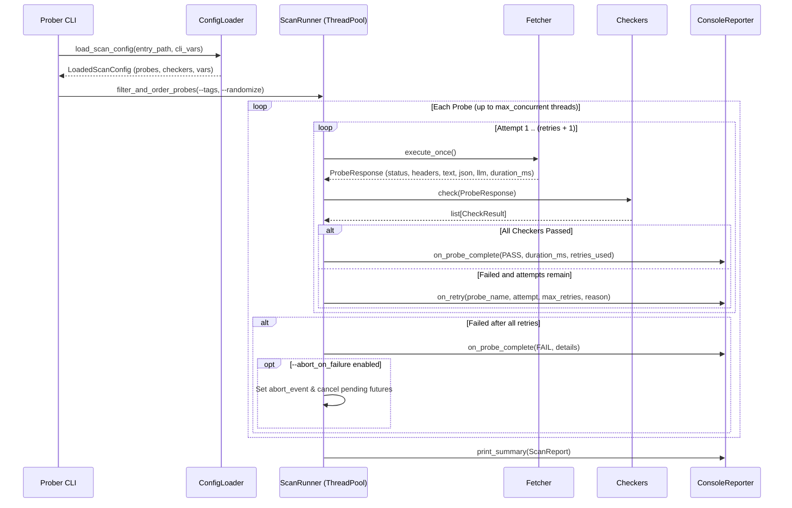

# Prober User Guide

`cb-api-prober` (`./prober`) is a zero-dependency, modular Python CLI tool for probing websites, JSON REST APIs, and LLM inference surfaces (OpenAI Chat Completions, OpenAI Responses, and Anthropic Messages).

It uses declarative **TOML scan configurations** that act like a lightweight domain-specific language with central variables, secure relative file imports, reusable named checkers, and tag-filtered concurrent probes.

---

## Documentation Index

- **[User Guide (this document)](./user-guide.md)** — CLI usage, scan-config structure, variables, imports, retries, and execution flow.
- **[Fetchers Reference](./fetchers-reference.md)** — All Fetcher types (`http_get`, `http_post`, `http_json`, `openai_chat_request`, `openai_responses_request`, `anthropic_messages_request`) and parameters.
- **[Checkers Reference](./checkers-reference.md)** — All Checker types (`http_status`, `response_time`, `content`, `header`, `json_path`, `json_schema`, `llm_response`) and condition operators.
- **[CoralBricks API Reference](./coralbricks-api-reference.md)** — Live reference specification for the CoralBricks Inference API (`scan-config/coralbricks/*`).

---

## 1. Quickstart

### Prerequisites
- Python 3.11+ (uses standard library `tomllib`, `urllib.request`, `ssl`, `concurrent.futures`; no `pip install` required).

### Running a Scan
```bash
# Run on Linux / macOS / Git Bash
./prober --scan-config="scan-config/coralbricks/main.toml" --tags="public"

# Run on Windows (PowerShell / CMD)
.\prober.cmd --scan-config="scan-config/coralbricks/main.toml" --tags="public"

# Or invoke directly via Python
python ./prober --scan-config="scan-config/coralbricks/main.toml" --tags="public"
```

### Supplying Secrets / Variables at Runtime
You can supply variables via environment variables or `--var KEY=VALUE` on the CLI:
```bash
# Via CLI --var override
./prober --scan-config="scan-config/coralbricks/main.toml" \
         --var coralbricks_api_key="cb_your_api_key_here" \
         --max-concurrent=10

# Or via environment variable (referenced in TOML as ${CORALBRICKS_API_KEY:-})
export CORALBRICKS_API_KEY="cb_your_api_key_here"
./prober --scan-config="scan-config/coralbricks/main.toml"
```

---

## 2. CLI Reference

```text
./prober --scan-config="path/to/main.toml" \
         [--tags="foo, baz, barz "] \
         [--max-concurrent=20] \
         [--randomize=true|false] \
         [--abort_on_failure] \
         [--include-debug=true|false] \
         [--report-performance=true|false] \
         [--var KEY=VALUE]
```

| Flag | Type / Default | Description |
| :--- | :--- | :--- |
| `--scan-config` | `string` *(required)* | Path to the entry TOML scan configuration file. All `imports` inside configs are resolved relative to their file location and confined to the entry file's directory tree. |
| `--tags` | `string` *(optional)* | Comma-separated list of tags to run (e.g. `--tags="smoke, public, Errors "`). Each tag is trimmed of whitespace and lowercased. A probe runs if it matches **at least one** specified tag. |
| `--max-concurrent` | `int` *(default: `10`)* | Maximum number of probes executed in parallel via `ThreadPoolExecutor`. |
| `--randomize` | `bool` *(default: `false`)* | Shuffles the selected probes in random order before execution. Accepts `--randomize`, `--randomize=true`, or `--randomize=false`. |
| `--abort_on_failure` / `--abort-on-failure` | `bool` *(default: `false`)* | Stops scheduling new probes and cancels pending probes immediately when the first probe fails (after exhausting its configured retries). |
| `--include-debug` | `bool` *(default: `false`)* | Outputs full formatted HTTP Request (method, URL, headers, body) and HTTP Response (status, latency, headers, pretty-printed JSON/text body, normalized LLM metadata) for every probe. |
| `--report-performance` | `bool` *(default: `false`)* | Appends a detailed performance analytics section after the `SCAN SUMMARY REPORT` header (Total/Slowest/Fastest/Average/Median/Requests per sec, 11-bin response time histogram, latency percentiles, socket phase timings, and HTTP status code distribution). |
| `--var` | `KEY=VALUE` *(repeatable)* | Overrides or defines a variable `${KEY}` in the scan config (takes highest precedence). |

### Exit Codes
- `0`: All executed probes passed (or no probes matched the tag filter).
- `1`: One or more probes failed (or scan aborted early on failure).
- `2`: Configuration syntax error, unresolved variable, or security violation (`ConfigSecurityError`).

---

## 3. How Scan Configs Work

A scan configuration is a `.toml` file composed of four optional sections:
1. **`imports`** — Array of relative paths to other `.toml` scan config files.
2. **`[variables]`** — Key-value pairs referenced anywhere via `${variable_name}` or `${variable_name:-default}`.
3. **`[[checkers]]`** — Reusable, named validation rules.
4. **`[[probes]]`** — Executable test definitions combining a `name`, `tags`, one `fetcher`, and a list of `checkers`.

### Minimal Self-Contained Example (`my_scan.toml`)

```toml
[variables]
base_url = "https://inference.coralbricks.ai/v1"
api_key = "${CORALBRICKS_API_KEY:-}"

[[checkers]]
name = "status_200"
type = "http_status"
equal = [200]

[[checkers]]
name = "fast_response"
type = "response_time"
max_duration = ["2s"]

[[checkers]]
name = "is_json"
type = "header"
header = "content-type"
contains = ["application/json"]

[[probes]]
name = "Check Public Models Endpoint"
tags = ["public", "smoke"]
checkers = [
    "status_200",
    "fast_response",
    "is_json",
    { name = "is_list_object", type = "json_path", path = "object", equal = ["list"] },
]
[probes.fetcher]
type = "http_get"
url = "${base_url}/models"
timeout = "5s"
retries = 2
```

---

## 4. Organising Modular Scan Configs (`imports`)

For larger projects (like `scan-config/coralbricks/`), split variables, checkers, and probes into logical files:

```text
scan-config/coralbricks/
├── main.toml
├── common/
│   ├── variables.toml
│   └── checkers.toml
└── probes/
    ├── models_and_quota.toml
    ├── inference_surfaces.toml
    └── errors_and_nonexistent.toml
```

### Entry File (`main.toml`)
```toml
imports = [
    "common/variables.toml",
    "common/checkers.toml",
    "probes/models_and_quota.toml",
    "probes/inference_surfaces.toml",
    "probes/errors_and_nonexistent.toml",
]
```

### Import Resolution & Security Rules
1. **Depth-First Merging**: Imported files are loaded in the order listed before the importing file's own declarations. Later files can override `[variables]` or `[[checkers]]` with the same name, while `[[probes]]` are appended in import order.
2. **Diamond-Import Safe**: If two probe files both import `common/checkers.toml`, it is only loaded once.
3. **Cycle Detection**: Circular imports (`a.toml -> b.toml -> a.toml`) are detected immediately and fail with a clear `ConfigError`.
4. **Path Confinement Security (`ConfigSecurityError`)**:
   - Every path in `imports` **must be relative**.
   - Every resolved import path **must stay inside the entry `--scan-config` file's directory or its subdirectories** (`candidate.resolve().is_relative_to(entry_dir)`).
   - Attempting to escape the root directory (e.g. `imports = ["../../etc/passwd"]`) or using an absolute path (`imports = ["/etc/hosts"]` or `C:\...`) raises `ConfigSecurityError` and aborts immediately.

---

## 5. Variables & Interpolation (`${...}`)

Variables defined under `[variables]` can be interpolated **anywhere** in string values (URLs, bearer tokens, headers, JSON bodies, checker parameters, or even other variables).

```toml
[variables]
host = "https://inference.coralbricks.ai"
base_url = "${host}/v1"
coralbricks_api_key = "${CORALBRICKS_API_KEY:-}"
timeout_val = "10s"
```

### Interpolation Syntax
- `${var_name}`: Resolves `var_name`. Raises `ConfigError` if undefined everywhere.
- `${var_name:-fallback}` (or `${var_name-fallback}`): Uses `fallback` if `var_name` is unset or empty.

### Resolution Precedence (Highest to Lowest)
1. **CLI `--var key=value`**
2. **`[variables]` in TOML** (if non-empty)
3. **OS Environment Variable** (`os.environ[key]` or `os.environ[key.upper()]`)
4. **Inline fallback** (`${key:-fallback}`)

> **Tip**: Safe type coercion is built in. If you interpolate a variable into a numeric or boolean fetcher/checker field (such as `retries = "${default_retries}"` or `ignore_verify_certificate_validity = "${skip_tls}"`), string values like `"3"` or `"false"` are automatically coerced to `3` (`int`) and `False` (`bool`).

---

## 6. Execution Lifecycle, Retries & Reporting



### How Retries Work
When a fetcher specifies `retries = 5` and `retry_delay = "200ms"`:
1. The probe runs its initial attempt (`Attempt 1`).
2. If a transport error occurs **or** any checker fails, the runner logs a live retry message:
   ```text
   [RETRY 1/5] Flaky Endpoint Probe -> Checker [status_200] (http_status) FAILED: HTTP status 503 failed check
   ```
3. The worker waits `retry_delay` and tries again, up to `5` retries (`6` total attempts).
4. If **any** attempt within the retry budget passes all checkers, the probe is marked **`PASS`** and reports how many retries were needed both on its live status line and in the final `SCAN SUMMARY REPORT`.
5. Duration Strings: Both `timeout`, `retry_delay`, and `response_time` checkers accept human-readable durations:
   - Milliseconds: `"200ms"`, `"50ms"`
   - Seconds: `"10s"`, `"1.5s"`
   - Minutes / Hours: `"4m"`, `"1h"`
